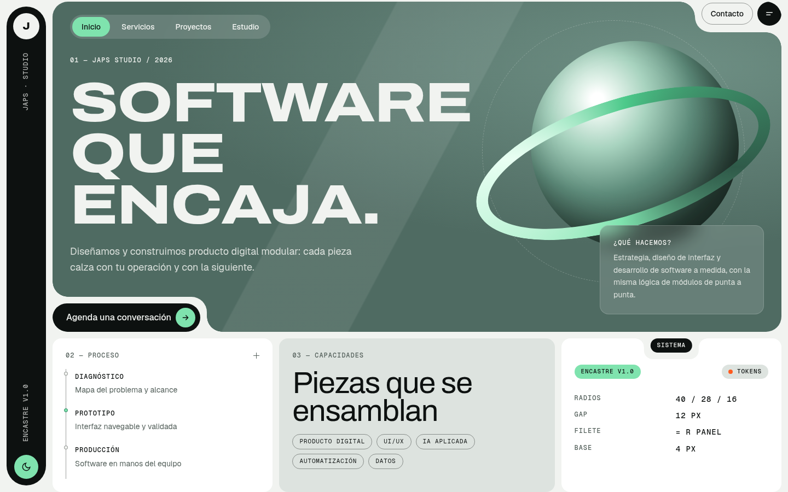
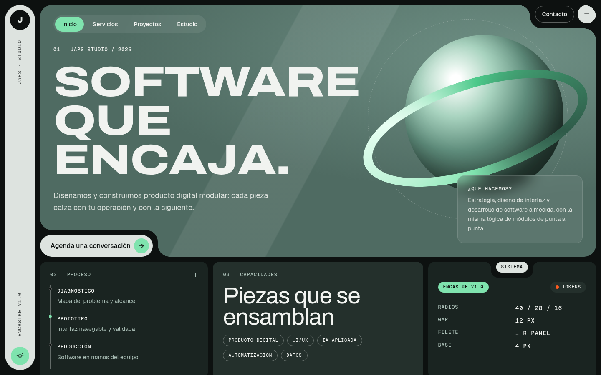

# JAPS Studio — Dirección de arte "Encastre" v1.0

**Estado:** dirección seleccionada para desarrollo; todavía no es una identidad validada con público.
**Fecha:** 20 de octubre de 2026.
**Fuente:** moodboard `referencias/pinterest-japs-studio/` (36 imágenes). Las bases son **12** (NEXA / Wix Studio) y **21** (Futuristic technologies).
**Archivos:** `tokens.json` (fuente de verdad, formato W3C DTCG) · `theme.css` (implementación) · `fonts/` (fuentes autoalojadas) · `cards/` (tarjetas `@dsCard` para Claude Design) · `preview.html` (kit de interfaz) · `scripts/` (verificación, fuentes y empaquetado). El punto de entrada es `README.md`.




---

## 1. Lectura del moodboard

| Capa | Qué se observa | Referencias |
| --- | --- | --- |
| **Estructura** | Paneles de radio amplio que *encastran*: el espacio negativo de la carcasa rodea un control (CTA, menú o titular) y lo une al panel con un **filete inverso** (curva cóncava). El hueco entre la muesca y el panel es constante y los radios son concéntricos. | **12**, **21**, 03, 08, 10, 13, 15, 18 |
| **Dato** | Lenguaje HUD/FUI: etiquetas mono en mayúsculas, índices `01 —`, cruces `+`, seriales, códigos de barras y líneas de tiempo con nodos. Los chaflanes de 45° de estas referencias **se descartan**: todos los componentes son curvos. | 04, 06, 20, 22–27, 30–36 |
| **Superficie** | Capas planas diferenciadas por color, sin sombras estructurales. El vidrio esmerilado solo aparece sobre imagen. Pills y tags usan contorno de 1 px. | 05, 12, 15, 16, 18, 21 |
| **Imagen** | Un objeto 3D protagonista (cromo, blanco o salvia) que interactúa con el borde del panel. | 12, 14, 19, 33 |

### Lo que se toma de cada base

**12 — NEXA**
- Marco oscuro que envuelve un panel salvia.
- Muesca superior derecha que aloja "Contact Us".
- Muesca inferior izquierda que aloja la CTA alargada.
- Navegación en pills con la activa en menta.
- Card de vidrio "What we do?".
- Statement en mayúsculas expandidas.

**21 — Futuristic technologies**
- Carcasa clara con sidebar en cápsula negra.
- Muesca inferior izquierda que aloja el titular.
- Muesca superior derecha que aloja el botón circular de menú.
- Tags de contorno.
- Línea de tiempo con puntos.
- Titular en caja mixta de grotesca neutra.

**Lo que no se traslada:** composición exacta, logotipos, fotografías y textos de las referencias. Se estudia el principio (muesca + filete + gap constante), no la pieza.

---

## 2. Mood y adjetivos rectores

**Concepto:** *Encastre*. Las piezas de interfaz encajan como hardware modular: **la curva construye y el dato anota.**

**Modular · Fluido · Preciso · Luminoso · Geek-lúdico**

| Adjetivo | Conducta visual | Límite |
| --- | --- | --- |
| Modular | Paneles y cards que calzan entre sí con gap constante | No fragmentar contenido que se lee de corrido |
| Fluido | Filetes inversos y radios concéntricos; transiciones suaves | No usar curvas libres "blob" ni ondas decorativas |
| Preciso | Retícula de 4 px, cifras tabulares, labels mono | No convertir la interfaz en un plano técnico |
| Luminoso | Menta sobre salvia o ink; vidrio sobre render | Máximo 10 % de acento por vista |
| Geek-lúdico | Detalles HUD: índices, `+`, seriales, labels mono | **1–2 detalles HUD por viewport**, nunca sobre texto de lectura |

---

## 3. Paleta y distribución

| Rol | Token | HEX | Uso |
| --- | --- | --- | --- |
| Base | `paper` | `#F1F3F0` | Carcasa clara |
| Base | `surface` | `#FFFFFF` | Cards en claro |
| Base | `mist` | `#DDE3DF` | Superficie secundaria clara; inverso en oscuro |
| Estructura | `ink` | `#0D1110` | Texto, sidebar, carcasa oscura |
| Estructura | `graphite` / `graphite-2` | `#1A2421` / `#24302C` | Cards en oscuro |
| Estructura | `slate` | `#56625D` | Texto secundario en claro |
| Estructura | `sage` | `#4F6B62` | Panel hero (igual en ambos modos) |
| Estructura | `sage-soft` | `#A9BDB5` | Texto secundario en oscuro |
| Acento | `mint` | `#7FE3AE` | CTA, nav activa, highlight |
| Acento | `mint-deep` | `#4CC98A` | Hover y pressed |
| Acento | `mint-ink` | `#1F7A55` | Acento **como texto o foco** sobre claro |
| Señal | `signal` | `#FF5B1F` | "En vivo" o alerta: un dato por vista |

**Dos modos al mismo nivel.** Ningún modo es el principal: `[data-theme="light"]` y `[data-theme="dark"]` están completos, y sin atributo el sitio sigue a `prefers-color-scheme`. Un componente solo está terminado cuando se ve bien en ambos.

| Modo | 60 % | 30 % | 10 % |
| --- | --- | --- | --- |
| Light | paper / surface | ink (sidebar, texto) · sage (hero) | mint (+ signal ≤ 2 %) |
| Dark | ink / graphite | sage (hero) · mist (sidebar) | mint (+ signal ≤ 2 %) |

**Reglas de contraste** (medidas con `scripts/check_tokens.py`, todas pasan):
- Texto principal ≥ 14:1 en ambos modos. Texto secundario ≥ 4.89:1. Texto sobre el panel sage: 5.21:1.
- Ink sobre mint: 12.22:1. Este es el único uso de mint con texto encima.
- **Prohibido:** mint como texto sobre claro (1.6:1). Para eso se usa `mint-ink` (4.74:1 sobre paper y 5.29:1 sobre surface).
- **Prohibido:** signal como texto sobre claro (2.78:1). Signal se usa solo como relleno con texto ink (6.13:1).
- Mint sobre sage: 3.74:1. Sirve para controles activos y foco dentro del panel; no para texto pequeño.
- El color nunca es la única señal: los estados llevan texto, forma o posición.

---

## 4. Tipografía

| Papel | Familia | Ajuste | Referencia |
| --- | --- | --- | --- |
| **Statement** | Archivo (variable) | `wdth 125`, `wght 800`, MAYÚSCULAS, interlineado 0.92, tracking −0.02em | "WE BUILD DIGITAL" (12) |
| **Headline** | Archivo | `wdth 100`, `wght 400`, caja mixta, interlineado 0.92 | "Futuristic technologies" (21) |
| **H1–H2** | Archivo | `wght 600`, interlineado 1.1 | — |
| **Cuerpo / UI** | Geist | 400 / 500, 16/1.6, medida de 68 ch | — |
| **Label HUD** | Geist Mono | 500, 12 px, MAYÚSCULAS, +0.08em, cifras tabulares con cero cruzado | 22, 31, 34, 36 |

- **Escala fluida** (entre 360 y 1440 px): display-xl 44→128 · display-l 40→88 · h1 32→56 · h2 24→40 · h3 20→28 · body 16 · small 14 · label 12 · micro 11.
- **Licencia:** las tres familias tienen licencia SIL Open Font License. Están autoalojadas en `fonts/` (subconjuntos latin y latin-ext) con sus licencias, y se regeneran con `python3 -I scripts/vendor_fonts.py`.
- **Alternativa premium**, si más adelante se licencia: PP Neue Machina (display) + PP Neue Montreal (cuerpo).
- **Una sola voz display:** el statement expandido se reserva para un mensaje por vista. El resto de los titulares usa Archivo con ancho normal.

---

## 5. Reglas de composición

### 5.1 Espaciado
- **Base 4 px.** Escala: `4 8 12 16 24 32 48 64 96 128`.
- **Gap estructural** de 12 px en desktop y 8 px en móvil. Es la distancia entre paneles, entre cards y entre la muesca y el elemento que aloja. Es la constante que hace legible el encastre.

### 5.2 Radios concéntricos
`radio interior = radio exterior − gap`

| Nivel | Desktop | Móvil |
| --- | --- | --- |
| Shell | 40 | 28 |
| Panel | 28 | 20 |
| Card | 16 | 12 |
| Inner | 8 | 8 |
| Pill | 999 | 999 |

### 5.3 Muescas con filete inverso (núcleo del sistema)
Es la interacción entre secciones de 12 y 21. El shell "muerde" una esquina del panel y la transición forma una **S continua**: el panel gira convexo, baja por el costado de la muesca, la muesca dobla con su propio radio y el panel vuelve a girar convexo.

- **Dónde:** en las esquinas del panel; centrada arriba o abajo como pestaña de sección (`.notch--t`, `.notch--b`; refs. 02, 15 y 16); o centrada en un lateral (`.notch--l`, `.notch--r`) con un control vertical (`IconButton` + `HudLabel vertical`). La **escalera** (`.notch-stair`) es una muesca de esquina inferior con 2–3 peldaños de al menos 56 px, cada uno con una pieza.
- **Cuántas:** máximo 2 por panel y en **posiciones opuestas** (TR + BL como en 12 y 21, TL + BR, L + R o T + B). La escalera cuenta como una.
- **Qué alojan:** un único elemento (CTA, menú, titular, selector o pestaña). **No se usan muescas vacías.**
- **Radio del filete:** siempre el del panel (`--notch-r: var(--r-panel)`). Si la pestaña va sobre una card, el filete usa el radio de la card.
- **Color:** el contenido de la muesca vive sobre el shell, no sobre el panel, y por eso usa `--text`.
- **Móvil:** la muesca TR se mantiene. Las muescas inferiores con `.notch--stack` se apilan como bloque.
- **Implementación** (`theme.css` §7): `.notch` es un bloque del color del shell con su radio interior. `::before` y `::after` dibujan los dos filetes con `radial-gradient(circle at …, transparent r, shell r)`. No necesita SVG ni JS y se adapta a cualquier contenido.

```html
<section class="panel">
  …
  <div class="notch notch--tr"><a class="pill" href="#">Contacto</a></div>
  <div class="notch notch--bl notch--stack"><a class="pill pill--lg pill--solid" href="#">Agenda…</a></div>
</section>
```

### 5.4 Todo es curvo
- **Ningún componente lleva esquinas rectas ni cortadas a 45°.** Shell, panel, card, pill, botón, tag y chip usan siempre un radio de la escala concéntrica.
- **Chips de dato** (`.chip`): índices, contadores, estados y versiones son cápsulas rellenas (`--r-pill`). Se distinguen de los tags de contorno por el relleno, no por la forma.
- **Dónde sigue el carácter geek:** en la tipografía mono, los índices `01 —`, las cruces `+` y las líneas de tiempo con nodos, no en la geometría de los componentes. Las líneas rectas sí se permiten (divisores, líneas de tiempo, órbitas), pero no las cajas rectas.

### 5.5 Bordes vs. sombras
| Recurso | Cuándo |
| --- | --- |
| **Contraste de superficies** | Siempre: es la forma de dar profundidad. No hay sombras estructurales. |
| **Hairline de 1 px** (ink al 12 % / paper al 10 %) | Pills, tags, divisores y nodos de línea de tiempo |
| **Hairline fuerte** (ink al 40 % / paper al 35 %) | Contorno de pills y tags interactivos |
| **Vidrio** (blur 16 px, blanco al 8–14 %, borde blanco al 14–18 %) | **Solo sobre imagen, render o panel salvia** (card "¿Qué hacemos?", nav del hero, controles `.glass-ctl`, aro de la consola) |
| **`--shadow-float`** (0 12 32, ink al 14 %) | Única sombra permitida: popovers y menús flotantes |
| **Foco** | Anillo de 2 px con offset de 2 px: `mint-ink` en claro, `mint` en oscuro y dentro del panel |

### 5.6 Movimiento
- **Curva:** `cubic-bezier(.2,.8,.2,1)`. **Duraciones:** 120 / 200 / 320 / 560 ms.
- **CTA:** el círculo con la flecha rota −45° y el fondo pasa a `mint-deep`.
- **Rellenos HUD** (`.hud-fill`): reaccionan al pasar el cursor (giran, se alargan, se completan o cuentan desde cero) en 420 ms con la misma curva y se invierten al salir. Sus puntos "en vivo" respiran en bucle lento (1,4 s): es el único movimiento del sistema que no responde a una acción.
- **Reducción:** con `prefers-reduced-motion` todas las transiciones quedan en 0 ms y los rellenos HUD quedan quietos, con las cifras en su valor real. El estado se entiende sin animación.

### 5.7 Imagen
- **Protagonista:** un objeto 3D por vista (cromo, blanco o salvia frío) que puede cruzar el borde del panel o quedar parcialmente detrás del vidrio.
- **Prohibido:** stock genérico y personas posando sin acción.
- **Texto sobre imagen:** solo sobre zonas planas o con vidrio detrás.
- **Anotaciones sobre imagen** (tags agrupados, etiquetas con puntero, callouts con guía): como máximo 2–3 por imagen, apuntando a partes reales del objeto.
- **Titular de exhibición** (`.display-title`): un titular enorme queda detrás del objeto protagonista, partido en diagonal, condensado o girado sobre el borde. Cuenta como el statement de la vista.

---

## 6. No hacer
- Más de 2 muescas por panel (la escalera cuenta como una), muescas vacías o muescas en posiciones adyacentes.
- Radios que no respeten la relación concéntrica, o un gap distinto entre muesca y panel.
- Mint o signal como texto sobre fondos claros.
- Sombras para separar paneles, o vidrio sobre fondos planos.
- HUD decorativo encima de texto de lectura, o más de 2 detalles HUD por viewport.
- Componentes con esquinas rectas o con chaflán (`clip-path` poligonal), incluidos chips, badges y etiquetas.
- Más de un statement expandido por vista (un titular de exhibición cuenta como statement).
- Más de 2–3 anotaciones por imagen, o anotaciones que no señalan nada real.

---

## 7. Uso y mantenimiento
1. Enlazar `theme.css` y fijar `data-theme` en `<html>`, u omitirlo para seguir al sistema.
2. Usar los tokens semánticos (`--text`, `--surface`, `--accent`…), nunca los primitivos `--c-*` directamente, salvo excepciones documentadas.
3. Cualquier cambio de color se hace primero en `tokens.json`, después se refleja en `theme.css`, y al final se corre:
   ```sh
   python3 -I design-system/scripts/check_tokens.py
   ```
   El script verifica el contraste WCAG 2.2 de los pares semánticos en ambos modos (sin redondear a favor) y que no queden variables CSS sin definir.
4. **Pendientes antes de dar la identidad por cerrada:**
   - Logotipo definitivo (el espécimen usa una "J" provisional).
   - Revisión de contraste del texto sobre fotografías reales.
   - Revisión completa de accesibilidad: teclado, foco y lectores de pantalla en los componentes reales.
