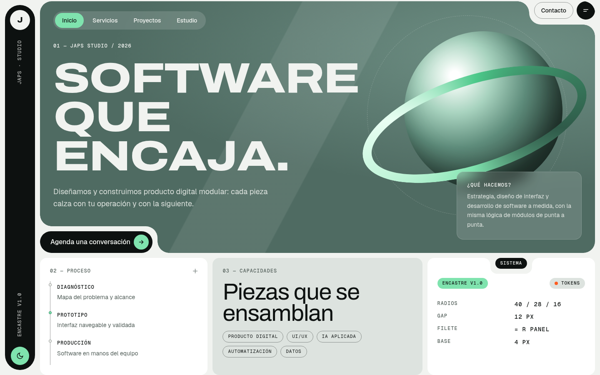
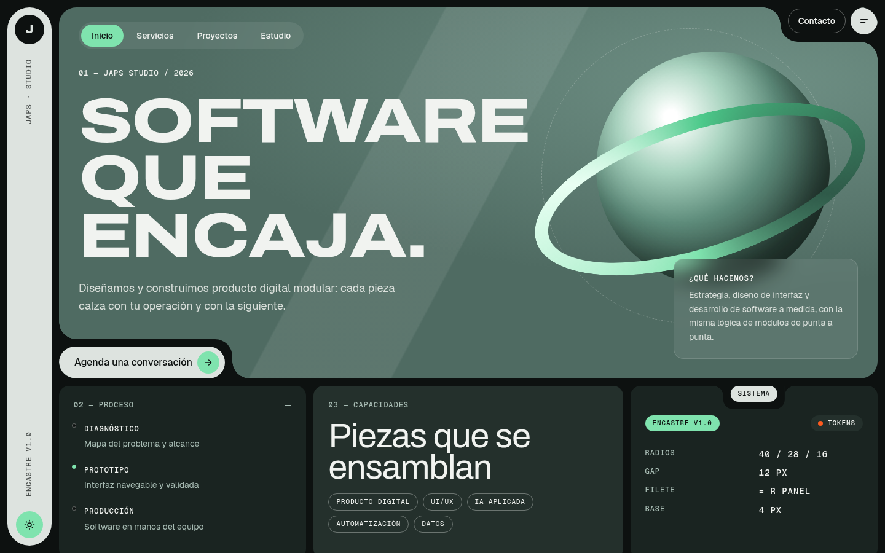

# JAPS Studio · Sistema de diseño "Encastre" v1.0

Paquete para crear el sistema de diseño de **JAPS Studio** en Claude Design. Está pensado para que cualquier pantalla nueva (landing, dashboard o presentación) salga con la misma línea gráfica: **limpia, futurista, llamativa y geek, sin excesos.**

> **Concepto:** las piezas de interfaz *encajan* como hardware modular. La curva construye y el dato anota.
> **Palabras clave:** Modular · Fluido · Preciso · Luminoso · Geek-lúdico.




---

## Instrucciones para Claude Design

1. **Fuente de verdad:** `tokens.json` (formato W3C DTCG). `theme.css` es su implementación directa. No inventes valores fuera de estos tokens.
2. **Usa siempre `theme.css`** y sus clases (ver el inventario). Dentro de los componentes usa los tokens **semánticos** (`--text`, `--surface`, `--panel`, `--accent`…) y nunca los primitivos `--c-*`.
3. **Dos modos al mismo nivel:** todo componente se diseña y se revisa en `[data-theme="light"]` y `[data-theme="dark"]`. Ningún modo es el principal; sin atributo, se sigue a `prefers-color-scheme`.
4. **La firma del sistema son las muescas con filete inverso** (`.notch--*`). Estúdialas en `cards/notch.html` y en `preview.html` antes de componer.
5. **Tarjetas de vista previa:** los HTML de `cards/` y `preview.html` empiezan con `<!-- @dsCard group="…" -->` y alimentan el panel de Design System. Los grupos son Colors, Type, Spacing, Brand, Components y UI kit.
6. La dirección de arte completa, con su razonamiento y referencias, está en `DIRECCION-DE-ARTE.md`.

---

## Mapa de archivos

| Ruta | Qué es |
| --- | --- |
| `tokens.json` | Tokens DTCG: color (primitivos + light + dark), tipografía, espacio, gap, radios, muesca, bordes, sombra, blur, motion y layout |
| `theme.css` | Punto de entrada CSS: importa `fonts/fonts.css` y `encastre.css`. No necesita build |
| `encastre.css` | Variables CSS, modos, base tipográfica y clases de componentes |
| `src/` · `package.json` | Librería React `@japs/encastre` (46 componentes sobre `encastre.css`, 24 de ellos del Notch Lab); `npm run build` genera `dist/` |
| `docs/components/` | Documentación por componente (uso, reglas y ejemplos JSX) |
| `fonts/` | Archivo, Geist y Geist Mono autoalojadas (woff2, latin + latin-ext) con su licencia OFL |
| `cards/*.html` | Tarjetas `@dsCard`: color, tipografía, espaciado y radios, muescas, botones, tags y chips, superficies, HUD |
| `preview.html` | Kit de interfaz: hero completo 12 + 21 con módulos y espécimen (`@dsCard group="UI kit"`) |
| `preview-light.png` / `preview-dark.png` | Capturas del kit a 1440 × 900 |
| `DIRECCION-DE-ARTE.md` | Documento de dirección: lectura del moodboard, mood, paleta, tipografía, composición y prohibiciones |
| `references/` | Referencias base del moodboard: **12** (NEXA) y **21** (Futuristic technologies), más apoyos de curvas |
| `scripts/check_tokens.py` | Verifica contraste WCAG 2.2 en ambos modos y que no haya variables CSS sin definir |
| `scripts/vendor_fonts.py` | Vuelve a descargar las fuentes y regenera `fonts/fonts.css` |
| `scripts/build_package.py` | Regenera este ZIP (corre primero `check_tokens.py`) |

---

## Reglas no negociables

1. **Muescas:** máximo 2 por panel, en **esquinas opuestas** (TR + BL o TL + BR). Cada una aloja **un único elemento** (CTA, menú, titular, selector o pestaña). No se usan muescas vacías.
2. **Radios concéntricos:** shell 40 → panel 28 → card 16 → inner 8 → pill 999 (interior = exterior − gap). El filete de una muesca usa el radio del panel. En móvil: 28 / 20 / 12, gap 8.
3. **Todo es curvo:** ningún componente lleva esquinas rectas ni chaflanes (`clip-path`). Las líneas rectas sí se permiten (divisores y líneas de tiempo).
4. **Gap constante de 12 px** (8 en móvil) entre paneles, entre cards y entre una muesca y lo que aloja.
5. **Color 60 · 30 · 10:** base / estructura (ink, salvia) / menta. La señal naranja va dentro del 10 % y se usa para un solo dato por vista.
6. **Contraste:**
   - Menta **nunca** como texto sobre claro: se usa `--accent-text`.
   - Señal **nunca** como texto sobre claro: va como relleno con texto ink.
   - Menta sobre salvia solo para controles y foco.
7. **Profundidad por color, no por sombra:** se usa hairline de 1 px. El vidrio va solo sobre imagen o render. `--shadow-float` queda solo para popovers y menús.
8. **Tipografía:** un solo statement expandido (`.t-statement`) por vista. Archivo para titulares, Geist para lectura y Geist Mono para la capa de datos.
9. **HUD con mesura:** máximo 1 o 2 detalles HUD por viewport, nunca sobre texto de lectura, y cada índice o serial debe referirse a algo real.
10. **Imagen:** un objeto 3D protagonista (cromo, blanco o salvia frío) por vista. Sin stock genérico.

---

## Inventario de componentes (`theme.css`)

| Componente | Clases | Notas |
| --- | --- | --- |
| Carcasa | `.shell` | Fondo `--shell`, radio 40 |
| Panel | `.panel` | Salvia en ambos modos; contiene muescas |
| Muesca | `.notch` + `--tr` `--tl` `--br` `--bl` `--t` `--b` `--l` `--r` · `.notch--stack` · `.notch-stair` | Filetes con `::before`/`::after`; se ajusta con `--notch-r` y `--shell-color` |
| Card | `.card` · `--muted` · `--inverse` | Radio 16 |
| Cápsula | `.capsule` | Sidebar vertical (ref. 21) |
| Pill / botón | `.pill` · `--accent` · `--solid` · `--glass` · `--lg` | Altura de 40 px (52 en `--lg`) |
| Icono circular | `.icon-btn` · `--inverse` · `.pill__icon` | 44 px; rota −45° en hover |
| Tag | `.tag` | Contorno de 1 px, mono en mayúsculas |
| Chip | `.chip` · `--accent` · `--inverse` · `--signal` | Cápsula rellena para datos |
| Vidrio | `.glass` | Solo sobre imagen o render |
| Popover | `.popover` | Única sombra permitida |
| HUD | `.hud-label` · `.hud-cross` · `.hud-rule` · `.timeline` · `.live-dot` | `li[aria-current="step"]` marca el paso activo |
| Tipografía | `.t-statement` · `.t-headline` · `.t-h1`–`.t-h3` · `.t-body-l` · `.t-small` · `.t-muted` · `.t-accent` · `.t-condensed` | Escala fluida con `clamp()` |
| Controles de vidrio | `.glass-ctl` (`--light` `--tinted` `--solid` `--bare`) · `.button-rail` · `.split-action` · `.double-btn` · `.key` | Hover por `[data-hover]`; botón expandible con `[data-expanded]` |
| Marca | `.studio-mark` · `.logo-bar` | Sello del estudio y barra de logos |
| Navegación | `.site-header` · `.search-field` · `.account-cluster` · `.index-list` · `.section-index` · `.vertical-nav` | Cabecera, buscador, cuenta e índices de página |
| Sobre imagen | `.tag-cluster` · `.pointer-label` · `.callout` · `.callout-meter` | Coordenadas en px dentro de un contenedor `relative`; 2–3 por imagen |
| Tarjetas de caso | `.media-card` · `.hero-card` · `.history-stack` · `.console-ring` | Rejillas, titular sobre imagen, historial y consola con aro |
| Exhibición | `.display-title` (`--split` `--condensed` `--vertical`) | Titular tras un objeto; cuenta como statement |
| Rellenos HUD | `.hud-fill` · `--leader` · `--marked` | Movimiento con `data-hover` y `data-count`; respeta `prefers-reduced-motion` |

### Patrón canónico (refs. 12 y 21)

```html
<section class="panel">
  <nav class="pill--glass">…</nav>
  <div class="notch notch--tr">
    <a class="pill" href="#">Contacto</a>
    <button class="icon-btn icon-btn--inverse" aria-label="Abrir menú">…</button>
  </div>
  <h1 class="t-statement">Software que encaja.</h1>
  <div class="glass">…</div>
  <div class="notch notch--bl notch--stack">
    <a class="pill pill--lg pill--solid" href="#">Agenda una conversación <span class="pill__icon">→</span></a>
  </div>
</section>
```

---

## Valores clave

| Token | Light | Dark |
| --- | --- | --- |
| `--shell` | `#F1F3F0` | `#0D1110` |
| `--surface` | `#FFFFFF` | `#1A2421` |
| `--surface-2` | `#DDE3DF` | `#24302C` |
| `--panel` | `#4F6B62` | `#4F6B62` |
| `--inverse` | `#0D1110` | `#DDE3DF` |
| `--text` / `--text-muted` | `#0D1110` / `#56625D` | `#F1F3F0` / `#A9BDB5` |
| `--accent` / `--accent-hover` | `#7FE3AE` / `#4CC98A` | `#7FE3AE` / `#4CC98A` |
| `--accent-text` | `#1F7A55` | `#7FE3AE` |
| `--signal` | `#FF5B1F` | `#FF5B1F` |
| `--focus` | `#1F7A55` | `#7FE3AE` |

- **Motion:** `cubic-bezier(.2,.8,.2,1)`, con duraciones de 120 / 200 / 320 / 560 ms. Con `prefers-reduced-motion` todo queda en 0 ms.
- **Contraste verificado** con `python3 -I scripts/check_tokens.py`: los 34 pares pasan en ambos modos.

---

## Referencias

`references/` contiene imágenes de terceros del moodboard de Pinterest. **Son material de estudio y no se reproducen:** se toma el principio (muesca + filete + gap constante, panel salvia, sidebar en cápsula), no la composición, los logotipos ni las fotografías.

| Archivo | Qué aporta |
| --- | --- |
| `12-nexa-base.jpg` | **Base.** Marco oscuro, panel salvia, muescas TR y BL, pills, vidrio y acento menta |
| `21-futuristic-base.jpg` | **Base.** Carcasa clara, sidebar en cápsula, muescas BL y TR, tags de contorno y línea de tiempo |
| `15-curvas-orizon.jpg` | Muesca superior centrada (pestaña) y cards que muerden la imagen |
| `16-curvas-ai-platform.jpg` | Pestaña central con botón de reproducción y paneles con muesca |
| `18-curvas-mnear.png` | Cards encastradas con radios concéntricos |
| `03-curvas-konexy.png` | Muescas múltiples alrededor de widgets |
