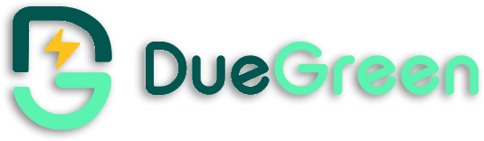

# PartnerTag

Logo de la empresa con la que se construyó un producto, sobre una cápsula blanca, precedido de «Junto a».

## Cuándo usarlo
- Siempre que aparezca un producto construido con una contraparte: Brixor con Nevermore, Project Check con DueGreen, Melian con Imaginería. Consenty, Relatio y Sonicali van sin contraparte.
- `plogo--mark` cuando el logo es un isotipo y necesita el nombre al lado.
- `partner--s` en espacios chicos (tarjetas del hero).

## Markup
```html
<span class="partner"><small>Junto a</small><span class="plogo"></span></span>
```

## Reglas
- La cápsula es blanca (`--paper`) para que el logo de la contraparte se lea con sus colores sobre el fondo oscuro.
- No se publican acuerdos económicos ni clientes piloto: solo el nombre y el logo.
